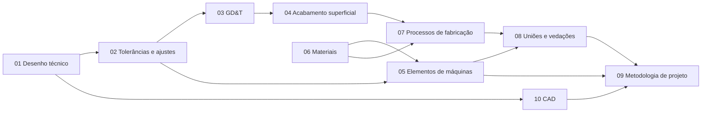

Notas de estudo de projeto mecânico, organizadas por módulo e ligadas entre si. O foco é o que um projetista usa no dia a dia: desenho, tolerâncias, elementos de máquinas, materiais e fabricação, sempre com exemplos da indústria (moenda, caldeiraria, transmissão de potência).

> [!info] Como usar
>
> Navegue pelo **Explorador** à esquerda, use a **busca** para achar um conceito ou abra o **grafo** à direita para ver como as notas se conectam. Convenções e legenda em [[00-indice/index|Como usar este mapa]].

## Mapa dos módulos

As setas indicam a ordem natural de estudo: cada módulo usa conceitos do anterior.

## Módulos

| Módulo | Do que trata | Notas |
|---|---|---|
| [[01-desenho-tecnico/index\|01 · Desenho técnico]] | Folhas, linhas, vistas, cortes, cotagem e escalas | 15 |
| [[02-tolerancias-ajustes/index\|02 · Tolerâncias e ajustes]] | Sistema ISO, furo-base e eixo-base, escolha de ajustes | 10 |
| [[03-gdt/index\|03 · GD&T]] | Tolerâncias de forma, orientação, posição e batimento | 11 |
| [[04-acabamento-superficial/index\|04 · Acabamento superficial]] | Rugosidade, parâmetros e indicação no desenho | 6 |
| [[05-elementos-de-maquinas/index\|05 · Elementos de máquinas]] | Eixos, rolamentos, engrenagens, chavetas, parafusos, acoplamentos | 17 |
| [[06-materiais/index\|06 · Materiais]] | Aços, ferros fundidos, tratamentos térmicos e seleção | 11 |
| [[07-processos-fabricacao/index\|07 · Processos de fabricação]] | Usinagem, soldagem, caldeiraria, corte e dobra | 11 |
| [[08-unioes-vedacoes/index\|08 · Uniões e vedações]] | Uniões parafusadas e soldadas, retentores, gaxetas, o-rings | 9 |
| [[09-metodologia-de-projeto/index\|09 · Metodologia de projeto]] | Etapas, memorial de cálculo, padronização, lista de materiais | 9 |
| [[10-cad/index\|10 · CAD]] | AutoCAD, layers, blocos e padrão de detalhamento | 7 |
| [[99-referencias/index\|99 · Referências]] | Bibliografia, lista de normas e glossário | 3 |

## Por onde começar

1. [[01-desenho-tecnico/index|Desenho técnico]]: a base de tudo. Comece por [[Projeções ortográficas]] e [[Cotagem]].
2. [[02-tolerancias-ajustes/index|Tolerâncias e ajustes]]: o que transforma um desenho em peça montável. Veja [[Tipos de ajuste]].
3. [[05-elementos-de-maquinas/index|Elementos de máquinas]]: onde o cálculo encontra o desenho. Veja [[Fadiga de eixos]] e [[Vida de rolamentos]].

## Como estudar com este site

- Cada módulo termina com uma **revisão rápida** de 10 perguntas, com as respostas escondidas: tente responder antes de abrir.
- Muitas notas têm **exercícios resolvidos**: refaça as contas antes de ver a resolução.
- Os valores marcados com **⚠️ verificar** devem ser conferidos na norma ou no catálogo original antes de serem usados em projeto.
- Termos técnicos estão no [[99-referencias/glossario|glossário]]; as fontes, na [[99-referencias/bibliografia|bibliografia]] e na [[99-referencias/normas|lista de normas]].
